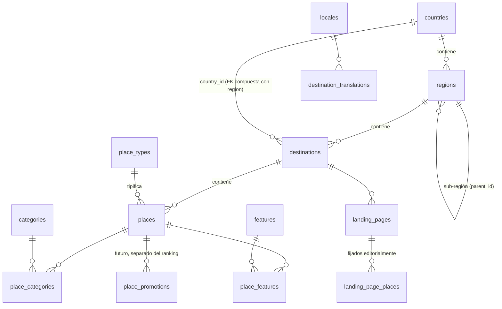

# Arquitectura

Principio rector: _¿seguiría funcionando con 500 destinos, 100.000 lugares, 10 idiomas y
millones de páginas vistas?_ Cada decisión de este documento responde a esa pregunta sin
optimizar prematuramente.

## 1. Visión general

```text
Navegador ──▶ proxy.ts ──▶ App Router (Server Components) ──▶ features/* ──▶ lib/db/rpc()
             (idioma,        páginas finas: componen          consultas      │
              segmentos      features + componentes           + lógica pura  ├─ Supabase (PostgREST RPC, RLS, caché por tag)
              localizados)                                                   └─ PGlite embebido (dev/CI/tests)
                                                                                   ▲
                                                     supabase/migrations + seed.sql (única fuente)
```

- **Rutas finas.** `src/app` solo resuelve parámetros, llama a `features/*` y compone
  componentes. La lógica vive en módulos testeables.
- **Una sola implementación de consultas.** Toda lectura pública es una función SQL
  (`api_*`) con respuesta JSON camelCase validada por Zod (`src/lib/db/contracts.ts`). En
  producción se llama vía Supabase RPC; en desarrollo, CI y tests, el mismo SQL se ejecuta en
  PGlite (Postgres real en WASM). No hay mocks ni una segunda implementación en JS.
- **Server-first.** Solo 3 componentes cliente: `LanguageMenu` (guardar preferencia),
  `OutboundLink` (evento de analítica) y `error.tsx`. Los filtros son formularios GET.

## 2. Modelo de datos



| Tabla                                     | Rol                                                                                                     |
| ----------------------------------------- | ------------------------------------------------------------------------------------------------------- |
| `locales`                                 | Idiomas de contenido (FK de todas las traducciones). Uno marcado como default.                          |
| `countries`, `regions`                    | Geografía. `regions.parent_id` permite niveles (Cataluña → Costa Daurada).                              |
| `destinations`                            | Lat/lng, imagen, `is_active`, `is_featured`, `timezone`. FK compuesta garantiza país coherente.         |
| `place_types`                             | Catálogo (`restaurant`, `bar`, `beach_club`, `hotel`…) con `schema_type` de Schema.org.                 |
| `places`                                  | Entidad genérica. Precio, rating atribuible (`rating_source`), `status`, `is_demo`, `ranking_score`.    |
| `categories` / `place_categories`         | Agrupaciones editoriales N:M (`group_code`: cuisine, dish, style, budget, audience, setting).           |
| `features` / `place_features`             | Atributos factuales N:M (terraza, vistas al mar, sin gluten…). Sin columnas booleanas.                  |
| `landing_pages` (+ `landing_page_places`) | Páginas SEO definidas por datos: destino + tipo/categoría + filtros + texto editorial.                  |
| `place_promotions`                        | Estructura futura de patrocinios. Sin acceso público. Nunca lee el ranking.                             |
| `place_secondary_types`                   | Tipos adicionales de un lugar (p. ej. cafetería + brunch). Filtros, listados y búsqueda los incluyen.   |
| `place_import_records`                    | Procedencia de lugares importados (fila original, fuente, observaciones, revisión). Sin acceso público. |
| `slug_aliases`                            | Slugs retirados (destino, tipo, categoría, landing, lugar) → redirección permanente a la URL actual.    |
| `*_translations`                          | Textos por idioma (ver §3).                                                                             |

Integridad: FKs en todas las relaciones, `unique` en el ámbito que exige la URL, dominios
`slug` y `code` con validación por regex, `check` de rangos (lat/lng, precio 1–4, rating 0–5),
un rating nunca puede existir sin `rating_source`, triggers `updated_at`, e índices para los
patrones de acceso reales (listado por destino+tipo+ranking, filtros por feature/categoría,
búsqueda trigram sin acentos por nombre, prefiltro geográfico).

Geodatos: `numeric(9,6)` + prefiltro por bounding box indexado + Haversine en SQL. Suficiente
para decenas de miles de lugares filtrando por destino. Migración a PostGIS cuando se necesiten
consultas espaciales complejas: añadir columna `geography(Point)` generada + índice GiST y
reescribir `api_nearby_places`; el contrato JSON no cambia.

## 3. Contenido multilingüe

### Decisión: tablas de traducción (B) frente a JSONB (A)

Se eligen **tablas `<entidad>_translations` con PK `(entidad_id, locale)`**:

| Criterio                              | JSONB `{es:…, en:…}`                         | Tablas de traducción (elegido)                             |
| ------------------------------------- | -------------------------------------------- | ---------------------------------------------------------- |
| Slugs localizados únicos              | Muy difícil (índices por expresión y locale) | `unique (locale, slug)` o `(destination_id, locale, slug)` |
| Añadir idioma                         | Sin migración, pero sin integridad           | Insertar fila en `locales`; FK garantiza validez           |
| Traducciones parciales                | Claves ausentes difíciles de consultar       | Fila ausente = "no traducido", consultable y medible       |
| Búsqueda full-text por idioma         | Índice por idioma sobre expresiones          | Índices por tabla/idioma directos                          |
| Edición en un CMS / flujo de revisión | Reescribe el documento entero                | Fila por idioma, con `updated_at` propio                   |
| Filas de 100k lugares × 10 idiomas    | Filas base muy pesadas                       | Base ligera; textos se leen solo en el idioma pedido       |

Fallback: las funciones SQL eligen `locale = pedido` y, si no existe, el idioma por defecto
(`order by locale = p_locale desc limit 1`), en una sola consulta.

- Destinos, lugares, categorías, tipos: **con fallback**. La página existe en todos los
  idiomas; si el contenido principal es un fallback, se sirve `noindex, follow` y no aparece
  en hreflang ni sitemap (evita contenido duplicado entre idiomas).
- Landing pages: **sin fallback**. Una guía editorial solo existe donde se ha escrito.
- Nombres de lugares: nombres propios en la tabla base, no se traducen; por eso su slug no es
  localizable (único por destino).

### UI vs contenido

| Tipo                      | Dónde                            | Cómo se usa                                          |
| ------------------------- | -------------------------------- | ---------------------------------------------------- |
| Textos de interfaz        | `src/lib/i18n/dictionaries/*.ts` | `getDictionary(locale)` en servidor, tipado estricto |
| Contenido dinámico        | Postgres `*_translations`        | Funciones `api_*` con fallback                       |
| Páginas fijas (legal…)    | `src/content/pages/*.ts`         | Documentos versionados; migrables a CMS              |
| Mensajes de error cliente | `src/lib/i18n/error-messages.ts` | Única excepción que viaja al cliente                 |

## 4. Rutas

| URL pública (es)                                                         | Ruta interna                                   | Tipo                            |
| ------------------------------------------------------------------------ | ---------------------------------------------- | ------------------------------- |
| `/es`                                                                    | `[locale]/page.tsx`                            | SSG + ISR 1 h                   |
| `/es/cambrils`                                                           | `[locale]/[destination]`                       | SSG (todos los destinos) + ISR  |
| `/es/cambrils/restaurantes`                                              | `[locale]/[destination]/[segment]`             | Dinámico (lee `searchParams`)   |
| `/es/cambrils/mejores-restaurantes`                                      | idem (landing page)                            | Dinámico                        |
| `/es/cambrils/arroces`                                                   | idem (categoría)                               | Dinámico                        |
| `/es/costa-daurada`                                                      | `[locale]/[destination]` (hub regional)        | SSG + ISR                       |
| `/es/cambrils/restaurantes/{slug}`                                       | `[locale]/[destination]/[segment]/[placeSlug]` | ISR bajo demanda                |
| `/es/buscar`                                                             | `[locale]/search`                              | Dinámico, `noindex`             |
| `/es/comer-y-beber`                                                      | `[locale]/directory`                           | Dinámico; con filtros `noindex` |
| `/es/sobre-nosotros`, `/es/privacidad`, `/es/cookies`, `/es/aviso-legal` | `[locale]/about…`                              | SSG                             |
| `/robots.txt`, `/sitemap.xml`, `/sitemaps/{id}.xml`                      | metadata route / route handlers                | Estático / ISR                  |

**Fichas** bajo su tipo principal: `/{idioma}/{destino}/{tipo}/{lugar}`. El lugar se identifica
por destino + slug; el segmento de tipo se deduce del propio lugar, así que cualquier otra grafía
(antiguas `/lugar/…`, tipo equivocado o desactualizado, slug de otro idioma o retirado) responde
308 hacia la URL canónica. **Hubs regionales** (`regions.is_hub`) comparten el nivel de URL de
los destinos (`/es/costa-daurada`); los destinos tienen precedencia. Detalle SEO:
[`docs/SEO.md`](SEO.md).

**Segmentos fijos** (`buscar`, `como-seleccionamos`, `aviso-legal`…) se definen en
`src/config/routes.ts`. Las antiguas palabras `lugar/lloc/place/lieu/ort/luogo` quedan reservadas.
`proxy.ts` reescribe el segmento localizado a la carpeta interna en inglés y redirige (308) la
grafía interna a la pública, así cada página tiene una sola URL. El proxy no escribe cookies,
de modo que las respuestas siguen siendo cacheables en la CDN.

**Segmentos dinámicos** (`/{destino}/{segmento}`) se resuelven en BD con
`api_resolve_destination_segment`, con precedencia **tipo de lugar → landing page →
categoría**. Si el slug pertenece a otro idioma se redirige (308) al slug del idioma pedido o
se devuelve 404 si no existe en ese idioma. `reservedSlugs` lista los slugs prohibidos.

`src/lib/routing/paths.ts` es la única forma de construir URLs (tests en `test/routing.test.ts`).

## 5. SEO

- Estrategia completa (arquitectura, intenciones, schema, enlazado, Search Console):
  [`docs/SEO.md`](SEO.md).
- **Metadata**: `buildMetadata()` centraliza title (`Título · Marca`, la marca solo si cabe), description truncada
  por palabra, canonical absoluto, hreflang (solo versiones existentes e indexables +
  `x-default` → español), Open Graph (`og:locale` + alternates) y Twitter cards.
- **JSON-LD** (`src/lib/seo/json-ld.ts`): solo con datos reales de la BD; propiedades vacías se
  omiten. Tipo de negocio desde `place_types.schema_type`. Lugares demo: sin marcado.
  `aggregateRating` solo para reseñas propias (`rating_source = 'internal'`): Google no permite
  marcar ratings copiados de terceros. Serialización con `<` escapado (anti-XSS).
- **Breadcrumbs** visibles y `BreadcrumbList` salen del mismo array.
- **Sitemaps**: `/sitemap.xml` (índice) → `core.xml` (home, about, destinos) +
  `destination-{slug}.xml` (listados, categorías con masa crítica, landings, lugares). Cada URL
  lleva su clúster hreflang. 500 destinos = 501 ficheros; cada uno muy por debajo del límite de
  50.000 URLs. Si un destino lo superase, se paginaría el id (`destination-{slug}-2`).
- **robots.txt**: bloquea todo salvo `ALLOW_INDEXING=true` con datos reales. No bloquea URLs
  con filtros: los crawlers deben poder leer su `noindex`.

### Estrategia de indexación (`src/lib/seo/indexing.ts`)

Primera regla que aplica:

1. Sitio no indexable (sin `ALLOW_INDEXING=true`, titular incompleto o datos embebidos/demo) → `noindex, nofollow`.
2. Buscador y páginas legales → `noindex, follow`.
3. Colección con refinamientos del usuario (precio, features, texto, orden…) → `noindex, follow`,
   canonical a la URL limpia.
4. Lugar demo → `noindex, follow`.
   Ficha sin aprobación y mínimos editoriales por idioma (ver `docs/PRODUCTION.md`) → `noindex, follow`,
   fuera del sitemap y sin marcado `LocalBusiness`.
5. Contenido principal en idioma de fallback → `noindex, follow`.
6. Landing sin `is_indexable`, texto propio suficiente o 3 resultados reales → `noindex, follow`.
7. Colección (tipo/categoría) con menos de `MIN_PLACES_FOR_INDEXABLE_COLLECTION` (3) lugares
   → `noindex, follow` (páginas finas).
8. Destino sin lugares → `noindex, follow`.
9. Resto → `index, follow`.

La paginación limpia (`?page=2`) es indexable con canonical propio. Las **landing pages** son
el mecanismo para crear páginas SEO por combinación (p. ej. "restaurantes románticos en
Cambrils") sin código nuevo: una fila en `landing_pages` + traducciones.

## 6. Búsqueda, ranking y recomendaciones

- **Estado en la URL** (`src/features/search/params.ts`): `destination`, `type`, `category`,
  `price` (repetible), `feature` (repetible), `q`, `sort`, `page`. Parser tolerante con Zod:
  valores inválidos se ignoran. Serialización con claves ordenadas → URLs estables.
- **`api_search_places`**: filtros combinables (features con semántica AND), búsqueda por
  palabras (todas deben aparecer) sin mayúsculas, acentos ni signos en nombre, dirección,
  especialidad (idioma pedido + fallback), tipo y nombre del destino **en cualquier idioma**
  ("Miami Playa" = "Miami Platja"); los signos nunca actúan como comodines. Orden orgánico,
  paginación con total, lugares fijados primero (landings).
- **Directorio "Comer y beber"** (`src/app/[locale]/directory`,
  `src/features/directory/state.ts`): `q`, `destination`, `type` y `page` en la URL; chips de
  localidad y categoría como enlaces (sin JS), orden alfabético y aviso de que no es un ranking.
  Los listados sin `ranking_score` muestran "Sin orden de preferencia".
- **Importaciones** de hojas de cálculo: ver [`docs/IMPORTS.md`](IMPORTS.md).
- **Ranking** (`src/features/ranking/ranking.ts`): `calculateRankingScore()` pura y
  documentada — media bayesiana del rating (prior 4.0 con peso 20), puntuación editorial y
  completitud del perfil; los pesos de señales ausentes se redistribuyen; popularidad y
  recencia tipadas con peso 0. Se ejecuta offline y persiste en `places.ranking_score`. Los
  patrocinios **no son un input** y viven en otra tabla.
- **Recomendador** (`src/features/recommendations`): interfaz `Recommender` +
  `getRecommendations(criteria)`. La v1 basada en reglas toma candidatos orgánicos y puntúa
  features, categoría, presupuesto, proximidad y rating, devolviendo los motivos
  (`feature_match`, `nearby`…). Sustituible por otra estrategia sin tocar llamadas.

## 7. Mapas

`src/lib/maps` define `MapProvider` (`embedUrl`, `viewUrl`, `frameOrigin` para la CSP). La
implementación activa es OpenStreetMap vía iframe perezoso: sin claves, sin JS. Para Mapbox,
Google Maps o Leaflet interactivo se implementa la interfaz y se exporta en
`src/lib/maps/index.ts` (tokens públicos siempre restringidos por dominio). "Cómo llegar" usa
la URL universal de Google Maps, independiente del proveedor.

## 8. Analítica y monetización (preparado, no activado)

- `src/lib/analytics`: eventos tipados (`outbound_click`, `search`) y `track()`, que solo
  empuja a `window.dataLayer` si un script (GA4/GTM) lo creó tras el consentimiento. Integrar
  GA4 (`NEXT_PUBLIC_GA_MEASUREMENT_ID`) se carga en `lazyOnload` con Consent Mode denegado por
  defecto (`src/components/layout/analytics.tsx`). Search Console: DNS o meta tag vía
  `GOOGLE_SITE_VERIFICATION` (ver `docs/SEO.md`).
- `OutboundLink` marca `rel="sponsored"` en enlaces de afiliación.
- AdSense/afiliación/patrocinios: `place_promotions` (placement + ventana temporal) sin acceso
  público. Regla: cualquier posición patrocinada se renderiza en un bloque propio y etiquetado,
  nunca mezclado con resultados orgánicos.

## 9. Administración futura

Sin CMS en esta fase: los datos se gestionan en Supabase y se invalida la caché con
`POST /api/revalidate`. Preparado para un panel: esquema normalizado con traducciones por fila,
`status` en lugares, `is_published`/`is_indexable` en landings, `updated_at` en todo, RLS que
ya separa lectura pública de escritura (solo service role). El panel usará Supabase Auth +
políticas de escritura por rol y `updateTag`/`revalidateTag` desde Server Actions.

## 10. Seguridad

- Validación Zod en entorno, parámetros de URL, filtros de landing y **respuestas de la BD**.
- Sin SQL dinámico con datos de usuario: RPC con parámetros; el driver embebido valida
  identificadores contra una lista cerrada.
- RLS en todas las tablas (verificado por test); `anon` solo lee contenido publicado.
- Claves de Supabase solo en servidor (`server-only`), nunca `NEXT_PUBLIC_`; service role
  fuera de la app.
- Sin HTML de la BD: textos planos divididos en párrafos (sin `dangerouslySetInnerHTML` salvo
  JSON-LD escapado).
- Cabeceras: CSP, `X-Frame-Options: DENY`, `nosniff`, `Referrer-Policy`,
  `Permissions-Policy`, HSTS. La CSP usa `'unsafe-inline'` en scripts porque Next inyecta
  scripts inline; pasar a nonces obligaría a renderizar todo dinámicamente (peor rendimiento).
- `/api/revalidate` con comparación en tiempo constante.

## 11. Rendimiento

- Server Components y cero dependencias de UI en cliente; filtros sin JS.
- Home, destinos y páginas fijas prerenderizadas con ISR (1 h); fichas ISR bajo demanda.
- Datos de Supabase en la caché de datos de Next con tag `content` (1 h, invalidable).
- `React.cache` deduplica consultas entre `generateMetadata` y la página.
- `next/image` (AVIF/WebP, `sizes` correctos, lazy salvo la imagen LCP con `preload`).
- Fuentes auto-alojadas con `next/font` (`display: swap`).
- Sin `loading.tsx` en rutas que pueden hacer `notFound()`: el streaming devolvería 200 en
  vez de 404. El buscador usa `Suspense` localizado.

## 12. Guías

### Añadir un destino

1. Insertar (si hace falta) `countries`/`regions` + sus traducciones.
2. Insertar `destinations` y una fila en `destination_translations` por idioma (slug, nombre,
   descripción, SEO opcional). Comprobar que el slug no está en `reservedSlugs`.
3. Si pertenece a una región hub (`regions.is_hub`), aparece en su página regional; para crear
   un hub nuevo: `is_hub = true` + `region_translations.description` por idioma.
4. Cargar lugares, categorías y features. `POST /api/revalidate`.
   Si se cambia un slug publicado, añadir el antiguo a `slug_aliases` (redirección 308).
   Aparece en home, footer, sitemap y rutas sin tocar código.

### Añadir un idioma (p. ej. `pt`)

1. Migración: `insert into locales (code, native_name, …) values ('pt', 'Português', …)`.
2. `src/config/i18n.ts`: añadir a `locales` y `localeMetadata`.
3. `src/config/routes.ts`: segmentos localizados (`staticPageSegments`, `placeSegment`).
4. `src/lib/i18n/dictionaries/pt.ts` (tipado: no compila si falta una clave) y registrarlo en
   `dictionaries.ts`; `src/content/pages/pt.ts` y `error-messages.ts`.
5. Traducciones en BD. Lo no traducido cae al español como `noindex` hasta traducirse.
   Los tests de i18n verifican claves y placeholders.

### Añadir un tipo de lugar (p. ej. `hotel`)

1. Fila en `place_types` (`schema_type = 'Hotel'`, `is_active = true`) + traducciones (nombre,
   plural y slug del listado, p. ej. `hoteles`).
2. Opcional: icono en `src/components/ui/icon.tsx` y features/categorías específicas.
   El listado `/es/{destino}/hoteles`, los filtros, el JSON-LD y el sitemap funcionan sin código.

### Crear una landing SEO

Fila en `landing_pages` (destino, `key`, tipo y/o categoría, `filters` JSON validado por
`landingPageFiltersSchema`, orden, `max_items`, `is_indexable`, `is_published`) + una fila de
`landing_page_translations` por idioma en el que exista. Lugares fijados opcionales en
`landing_page_places`.

## 13. Tests

| Suite                        | Cubre                                                                               |
| ---------------------------- | ----------------------------------------------------------------------------------- |
| `test/routing.test.ts`       | Constructores de URL, reescrituras/redirects del proxy, negociación idioma          |
| `test/seo.test.ts`           | Indexación, metadata/hreflang, JSON-LD (demo, ratings), sitemaps XML                |
| `test/domain.test.ts`        | Ranking, parámetros de búsqueda, filtros de landing, recomendador, entorno          |
| `test/i18n.test.ts`          | Paridad de claves y placeholders, contenido de páginas, plurales                    |
| `test/database.test.ts`      | Migraciones + seed en Postgres real, RLS, constraints y toda la API SQL             |
| `test/places-import.test.ts` | Lectura del Excel real, reglas de importación, fusión sin pisar ediciones, búsqueda |
| `scripts/smoke-test.mjs`     | Rutas, redirects, cabeceras, SEO, enlaces y sitemap; total calculado por el script  |

## 14. Preparación de producción

El bootstrap de taxonomía y geografía vive en la migración `production_bootstrap`, separado de
`seed.sql` (solo ejemplos). No depende de ejecutar un seed antes de importar. La migración
`public_content_quality` restringe demos y relaciones con RLS y predicados SQL invoker.
No se convierten funciones a `SECURITY DEFINER`: conservamos SELECT en tablas públicas y los
IDs que necesita la API para relaciones/filtros. Los UUID no son secretos; los registros de
importación y promociones siguen privados. Las relaciones de borradores/demos y aliases de
entidades ocultas no se exponen.

Las fichas exponen `indexableLocales`; destinos, categorías y landings, `indexableSlugs`.
SQL calcula candidatos editoriales para metadata/hreflang/sitemap; la decisión robots final
permanece en `resolveIndexing()`. Las landings demo también tienen `is_demo`. La vista demo
es opt-in solo para la conexión propietaria embebida; los roles públicos no pueden activarla.
Los sitemaps HTTP quedan vacíos mientras el sitio esté globalmente bloqueado para indexación.

Identidad pública en `src/config/publisher.ts` mediante variables validadas. La marca no cambia.
El titular incompleto mantiene bloqueada la indexación y muestra un aviso editorial en la página
legal. Configurar identidad requiere reconstruir las páginas estáticas y revisar los textos legales.

Flujo operativo y mínimos exactos: [`PRODUCTION.md`](PRODUCTION.md).
Auditoría reproducible: `npm run check:content`; informe: [`DATA-QUALITY.md`](DATA-QUALITY.md).
